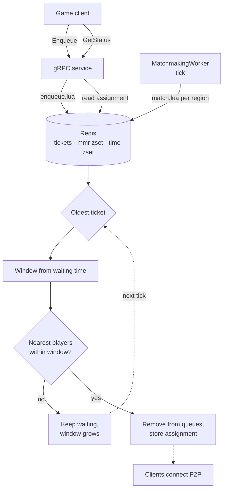

# Matchmaking

Skill-based matchmaking service I built for my P2P Sumo game. It groups players by MMR and region, and widens the MMR window the longer someone waits.

.NET Core, Redis and gRPC

## How it works

- One sorted set per region by MMR, and another one by enqueue time.
- Every tick (default 1 s), `match.lua` takes the oldest tickets first and picks the nearest players by MMR inside the window. It runs atomically.
- Window: `min(InitialTolerance + TolerancePerSecond * secondsWaiting, MaxTolerance)`.
- Clients use the gRPC API (`Enqueue`, `Cancel`, `GetStatus`). Once matched, they connect to each other directly.



## Run

```sh
docker-compose up -d
dotnet run -p src/Matchmaking.Server
```

Settings are in `appsettings.json`. You can override them with environment variables, for example `MATCHMAKING_Matchmaking__Redis=host:6379`.

## Tests

```sh
dotnet test tests/Matchmaking.Tests
MATCHMAKING_TEST_REDIS=localhost:6379 dotnet test tests/Matchmaking.Tests   # also runs the redis tests
```

The time comes from an injected clock, so the simulation is deterministic. It runs 10,000 players arriving over 5 minutes, in 1v1 matches with the default rules (50 + 5/s, max 500), and takes about 20 ms:

| Metric | Value |
|---|---|
| Matched players | 99.7 % |
| Avg / p95 wait | 1.23 s / 3.71 s |
| Avg / p95 MMR difference | 25.4 / 58 |
